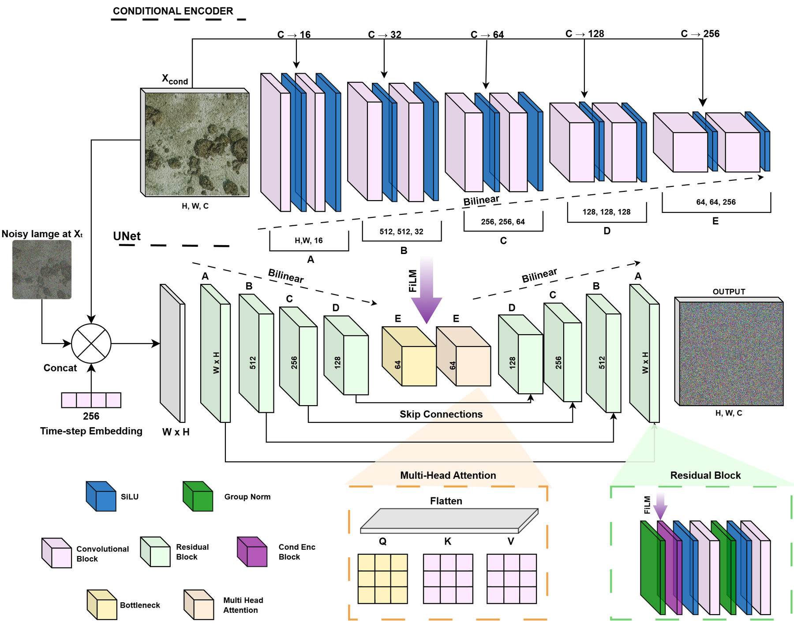
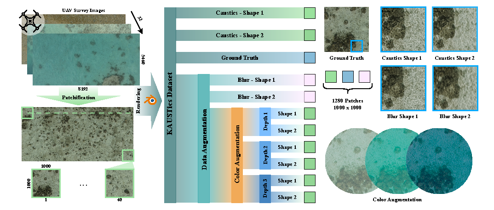
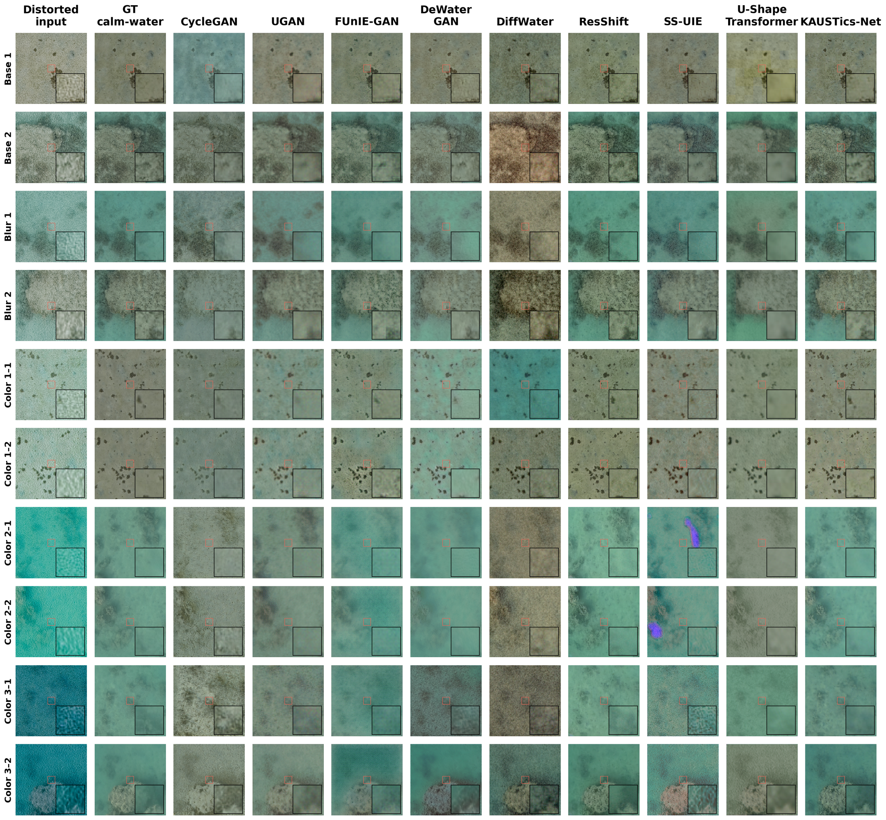

# KAUSTics-Net

Conditional **pixel-space diffusion** for restoring UAV images acquired through water. This release contains the final velocity-prediction model, training and sampler-aware Sea-Undistort fine-tuning code, fixed dataset partitions, and six selected checkpoints (three training seeds per dataset).



The conditional encoder supplies FiLM modulation and single-head bottleneck cross-attention. The model restores RGB directly; it does not require a latent autoencoder.

## Data and weights

| Resource | Download |
|---|---|
| KAUSTics: original patches and exact RGB256 cache | [Hugging Face dataset — placeholder](https://huggingface.co/datasets/YOUR_HF_USERNAME/KAUSTics) |
| KAUSTics-Net: KAUSTics and Sea-Undistort fine-tuned seeds 1–3 | [Hugging Face models — placeholder](https://huggingface.co/YOUR_HF_USERNAME/KAUSTics-Net) |
| Prepared Sea-Undistort experiment split | [Hugging Face dataset — placeholder](https://huggingface.co/datasets/YOUR_HF_USERNAME/Sea-Undistort-evaluation) |
| Original Sea-Undistort dataset | [Authors’ release](https://huggingface.co/datasets/maxkromer/Sea-Undistort) |

**The YOUR_HF_USERNAME links are placeholders, not published repositories.** Replace them after uploading. See [upload and sharing instructions](docs/HUGGINGFACE.md).



KAUSTics contains 1,280 reference patches and ten degraded variants per reference. All variants of a UAV source remain in one partition: **26/3/3 sources**, **1,040/120/120 references**, and **10,400/1,200/1,200 degraded views** for train/validation/test. The historical colour presets illustrated above are empirical augmentations, not measured depths. [Protocol details](docs/PROTOCOL.md).

## Quick start

Use Python 3.10 or 3.11 and a CUDA-capable PyTorch installation. The paper used PyTorch 2.6 / CUDA 12.6, FP32 and one A100 per seed. W&B is always disabled.

```bash
python -m pip install -r requirements.txt
# Once the placeholder repositories have been published:
python -m pip install -U huggingface_hub
python scripts/download_assets.py --namespace YOUR_HF_USERNAME --kind all

# Restore an image (input is resized to256; output is256 RGB).
python infer.py --checkpoint checkpoints/kaustics/seed1.pt --input image.png --output predictions/example

# KAUSTics training from scratch; repeat with --seed 2 and --seed 3.
python train.py --manifest data/kaustics/manifest_256.json --seed 1 --output runs/kaustics_seed1

# Fine-tune the corresponding KAUSTics checkpoint on Sea-Undistort.
python finetune.py --manifest data/sea_undistort/manifest.json --seed 1 \
  --init checkpoints/kaustics/seed1.pt --output runs/sea_seed1

# Evaluate the released fine-tuned model; repeat for no_waves and no_sunglint.
python infer.py --checkpoint checkpoints/sea_undistort/seed1.pt \
  --manifest data/sea_undistort/manifest.json --dataset sea_undistort \
  --variant all_effects --output predictions/sea_seed1_all_effects --lpips
```

Training defaults: 1,000 KAUSTics epochs; up to 100 Sea-Undistort fine-tuning epochs; batch size 12; one overwritten resumable `last.pt` and one validation-selected `best.pt`. Add `--resume` to continue the same run. Add `--smoke` with a separate output folder for a one-update correctness check (batch size 1). Test images never select checkpoints. [Exact settings and selected epochs](docs/PROTOCOL.md).

## KAUSTics restoration examples



The grid includes competitors for visual comparison. Their implementations and weights are not bundled; see [original project links](docs/COMPETITORS.md).

## Release contents

`kausticsnet/`, three entry scripts, `scripts/download_assets.py`, `requirements.txt`, documentation, figures and split manifests belong on **GitHub**. `huggingface/` contains the separate dataset/model upload payloads and is ignored by Git. After downloading, runtime pixels and weights under `data/` and `checkpoints/` are also ignored. Before publication, use the manifest and weight paths inside `huggingface/` directly; see [local data usage](data/README.md). Do not upload `runs/`, environments, caches or the entire working directory.

Sea-Undistort is attributed to Kromer, Agrafiotis and Demir (2025), [DOI:10.5281/zenodo.15639838](https://doi.org/10.5281/zenodo.15639838), under its upstream CC BY-NC-SA 4.0 terms. KAUSTics code/data/weight licensing is left for the authors to specify; this draft does not assign a new license.
